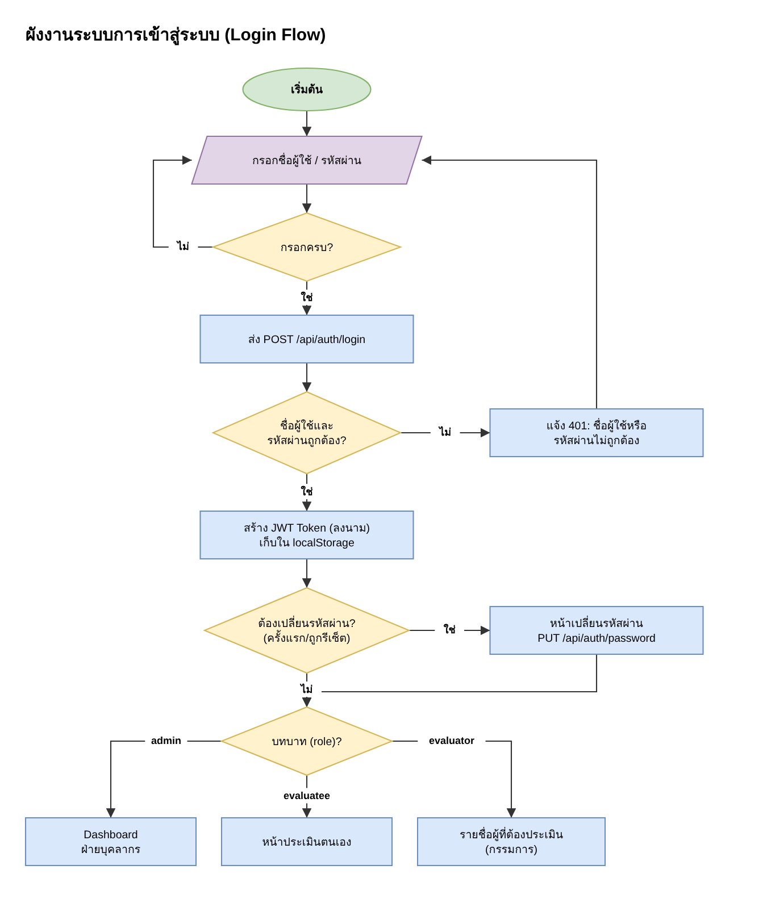
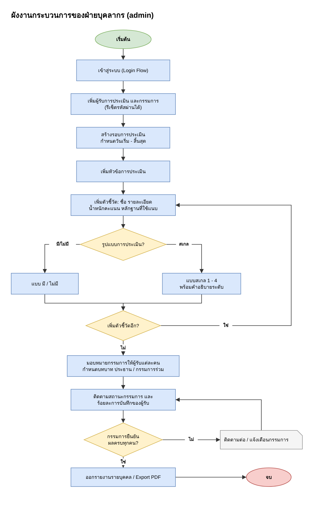
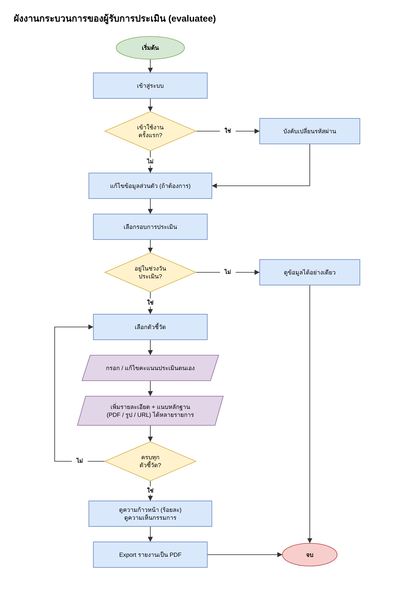
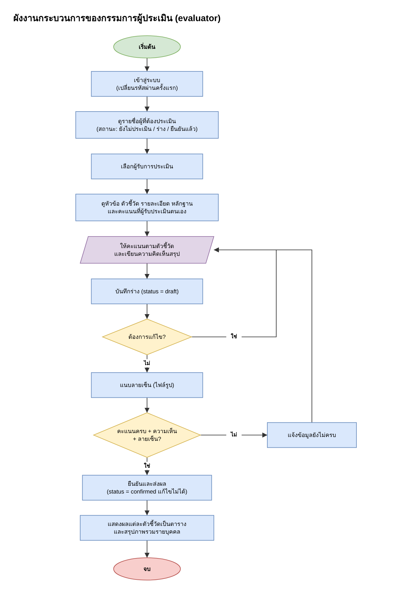
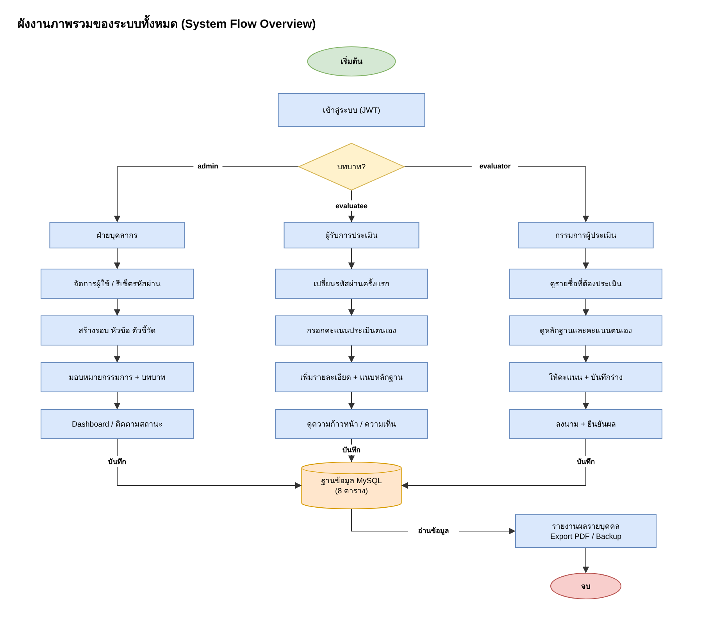

# 02 ส่วนที่ 1 การออกแบบผังงาน (Flow Diagram) — 5 คะแนน

ผู้รับผิดชอบ: **คนที่ 3** · ไฟล์ตัวอย่าง: `งานออกแบบ/1-ผังงาน.drawio` (มี 5 หน้า ดูแท็บด้านล่างของ Draw.io)

## 1. สัญลักษณ์ที่ใช้

| รูปทรง | ชื่อ | ใช้เมื่อ | ใน Draw.io หาที่ |
|---|---|---|---|
| วงรี สีเขียว / แดง | Terminator | จุดเริ่มต้น / จุดจบ | General → Ellipse |
| สี่เหลี่ยม | Process | การทำงาน 1 ขั้น | General → Rectangle |
| สี่เหลี่ยมด้านขนาน | Input / Output | ผู้ใช้กรอกข้อมูล | Flowchart → Data |
| สี่เหลี่ยมขนมเปียกปูน | Decision | คำถามที่ตอบ ใช่ / ไม่ | General → Rhombus |
| ทรงกระบอก | Database | ฐานข้อมูล | Flowchart → Database |
| ลูกศร | Flow line | ลำดับการทำงาน | ลากจากจุดสีน้ำเงินที่ขอบรูป |

## 2. วิธีใช้ Draw.io (เร็วที่สุด)

1. เปิด Draw.io → **Create New Diagram** → Blank Diagram → ตั้งชื่อ `1-ผังงาน.drawio` → Create
2. ลากรูปทรงจากแถบซ้ายมาวาง ดับเบิลคลิกเพื่อพิมพ์ข้อความ (ขึ้นบรรทัดใหม่ `Shift + Enter`)
3. เอาเมาส์ชี้รูป จะมี **ลูกศรสีฟ้า 4 ทิศ** ลากไปปล่อยบนรูปถัดไปจะได้เส้นเชื่อมทันที
4. ดับเบิลคลิกบนเส้นเพื่อพิมพ์ "ใช่" / "ไม่"
5. เปลี่ยนสี: เลือกรูป → แถบขวา Style → Fill
6. จัดให้ตรงกัน: เลือกหลายรูป (`Shift` + คลิก) → แถบขวา Arrange → Align Center
7. เพิ่มหน้าใหม่: กด `+` ที่แถบล่าง ดับเบิลคลิกชื่อหน้าเพื่อเปลี่ยนชื่อ
8. **บันทึกบ่อย ๆ** `Ctrl + S` และส่งออกภาพ File → Export as → PNG (ใช้ใส่สไลด์นำเสนอ)

> เคล็ดลับ: วาด Process 1 กล่องให้สวยก่อน แล้ว `Ctrl + D` (Duplicate) เพื่อได้ขนาดเท่ากันทุกกล่อง

## 3. ผังงานที่ต้องวาด 5 ภาพ

### 1.1 ผังงานระบบการเข้าสู่ระบบ (Login Flow)

จุดที่กรรมการดู
- ตรวจกรอกครบก่อนส่ง (Validate) และกรณีรหัสผิดต้องวนกลับไปกรอกใหม่
- หลังผ่านต้องสร้าง **JWT Token**
- มีทางแยก **บังคับเปลี่ยนรหัสผ่านครั้งแรก** (ข้อ 5.2.1)
- แยกหน้าแรกตาม **บทบาท** 3 แบบ

### 1.2 ผังงานกระบวนการของฝ่ายบุคลากร

ลำดับต้องตรงกับการใช้งานจริง: ผู้ใช้ → รอบ (วันเริ่ม-สิ้นสุด) → หัวข้อ → ตัวชี้วัด → เลือกรูปแบบ (มี/ไม่มี หรือ สเกล 1–4) → มอบหมายกรรมการ + บทบาท → ติดตามสถานะ → รายงาน

### 1.3 ผังงานกระบวนการของผู้รับการประเมิน

ต้องมี: เปลี่ยนรหัสครั้งแรก, ตรวจช่วงวันประเมิน, กรอกคะแนนตนเอง, **เพิ่มรายละเอียดได้หลายรายการ** + แนบหลักฐาน, วนจนครบทุกตัวชี้วัด, ดูความก้าวหน้า, ดูความเห็นกรรมการ, Export PDF

### 1.4 ผังงานกระบวนการของกรรมการผู้ประเมิน

ต้องมี: ดูหลักฐานและคะแนนตนเอง → ให้คะแนน + ความเห็น → **บันทึกร่าง** → แก้ไขร่างได้ → แนบลายเซ็น → ตรวจครบ → **ยืนยันส่งผล** (หลังยืนยันแก้ไม่ได้)

### 1.5 ผังงานภาพรวมของระบบ (System Flow Overview)

แสดง 3 บทบาทแยกเป็น 3 คอลัมน์ ทุกบทบาทบันทึกลงฐานข้อมูลเดียวกัน แล้วออกรายงาน

## 4. ซ้อมให้เร็ว

| รอบซ้อม | เป้าหมายเวลา |
|---|---|
| รอบ 1 ดูตามภาพ | 5 ภาพ ภายใน 90 นาที |
| รอบ 2 | ภายใน 60 นาที |
| รอบ 3 วาดจากความจำ | ภายใน 45 นาที |
