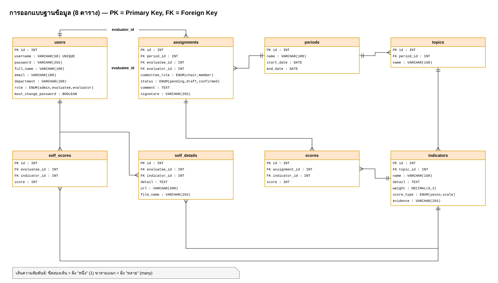
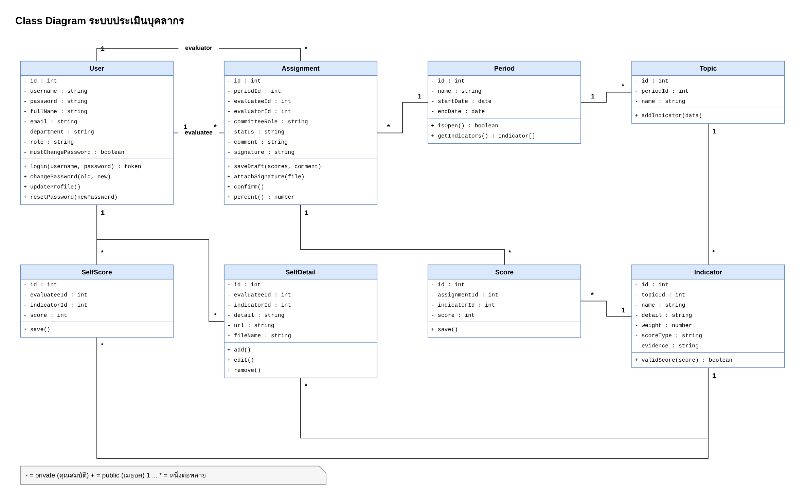

# 03 ส่วนที่ 2 การออกแบบฐานข้อมูล (Database Design) พร้อม Class Diagram — 5 คะแนน

ผู้รับผิดชอบ: **คนที่ 3** (วาด) + **คนที่ 1** (เขียน `schema.sql`) · ไฟล์ตัวอย่าง: `งานออกแบบ/2-ฐานข้อมูล.drawio`

## 1. ตารางทั้งหมด 8 ตาราง (ข้อ 2.1)



| ตาราง | เก็บอะไร | ความสัมพันธ์ (ข้อ 2.2) |
|---|---|---|
| `users` | ผู้ใช้ทุกคน แยกด้วย `role` | แม่ของ assignments, self_scores, self_details |
| `periods` | รอบการประเมิน + วันเริ่ม/สิ้นสุด | 1 รอบ มีหลายหัวข้อ, หลายการมอบหมาย |
| `topics` | หัวข้อการประเมิน | อยู่ใน 1 รอบ มีหลายตัวชี้วัด |
| `indicators` | ตัวชี้วัด ชื่อ รายละเอียด น้ำหนัก รูปแบบ หลักฐาน | อยู่ใน 1 หัวข้อ |
| `assignments` | กรรมการ 1 คน ประเมินผู้รับ 1 คน + บทบาท + **สถานะ** + ความเห็น + ลายเซ็น | ลูกของ users (2 เส้น) และ periods |
| `self_scores` | คะแนนที่ผู้รับประเมินตนเอง (ตัวชี้วัดละ 1 ค่า) | ลูกของ users, indicators |
| `self_details` | รายละเอียด + หลักฐาน (ตัวชี้วัดละ **หลายรายการ**) | ลูกของ users, indicators |
| `scores` | คะแนนที่กรรมการให้ | ลูกของ assignments, indicators |

> ทำไมแยก `self_scores` กับ `self_details`? เพราะเกณฑ์ 5.2.3 ให้ 2 คะแนนเมื่อเพิ่มรายละเอียดได้ **มากกว่า 1 รายการ** ถ้าเก็บรวมในตารางเดียวจะเก็บได้แค่ 1 รายการ

## 2. Data Dictionary — ชนิดข้อมูล (ข้อ 2.3)

| ข้อมูล | ชนิดที่เลือก | เหตุผล |
|---|---|---|
| รหัส (id) | `INT AUTO_INCREMENT PRIMARY KEY` | เลขเรียงอัตโนมัติ ไม่ซ้ำ |
| ชื่อผู้ใช้ | `VARCHAR(50) UNIQUE` | ข้อความสั้น ห้ามซ้ำ |
| รหัสผ่าน | `VARCHAR(255)` | เก็บแบบเข้ารหัส bcrypt (ยาว 60 ตัว) |
| บทบาท / สถานะ / รูปแบบคะแนน | `ENUM(...)` | มีค่าได้ไม่กี่แบบ ป้องกันพิมพ์ผิด |
| วันที่เริ่ม / สิ้นสุด | `DATE` | เก็บเฉพาะวันที่ |
| รายละเอียด / ความเห็น | `TEXT` | ข้อความยาว |
| น้ำหนักคะแนน | `DECIMAL(6,2)` | ทศนิยม 2 ตำแหน่ง แม่นยำ |
| คะแนน | `INT` | 0–1 หรือ 1–4 |
| ต้องเปลี่ยนรหัส | `BOOLEAN` | จริง / เท็จ |
| ชื่อไฟล์ | `VARCHAR(255)` | เก็บชื่อไฟล์ ตัวไฟล์อยู่ในโฟลเดอร์ uploads |

## 3. การตั้งชื่อ (Naming Conventions ข้อ 2.5)

- ชื่อตาราง: ภาษาอังกฤษ ตัวเล็ก **พหูพจน์** คั่นด้วย `_` เช่น `self_scores`
- ชื่อฟิลด์: ตัวเล็ก `snake_case` เช่น `full_name`, `start_date`
- Primary Key ชื่อ `id` ทุกตาราง
- Foreign Key ชื่อ `<ชื่อตารางแม่เอกพจน์>_id` เช่น `period_id`, `indicator_id` (ยกเว้น `evaluatee_id`, `evaluator_id` ที่บอกบทบาทของ user)
- ชื่อคลาสใน Class Diagram: เอกพจน์ ตัวแรกพิมพ์ใหญ่ `PascalCase` เช่น `SelfDetail`, คุณสมบัติแบบ `camelCase` เช่น `fullName`

## 4. Class Diagram (ข้อ 2.4)



ส่วนประกอบของ 1 คลาส (ใน Draw.io ใช้แถบซ้าย **UML → Class**)

```
┌───────────────────────┐
│ ชื่อคลาส (User)        │ ← ช่องบน
├───────────────────────┤
│ - id : int            │ ← คุณสมบัติ (attribute)  "-" = private
│ - username : string   │
├───────────────────────┤
│ + login() : token     │ ← เมธอด (method)  "+" = public
└───────────────────────┘
```

ความสัมพันธ์: ลากเส้นจากคลาสแม่ไปคลาสลูก แล้วพิมพ์ `1` ที่ฝั่งแม่ และ `*` ที่ฝั่งลูก (หมายถึง หนึ่งต่อหลาย)

| ความสัมพันธ์ | อ่านว่า |
|---|---|
| Period 1 — * Topic | 1 รอบ มีได้หลายหัวข้อ |
| Topic 1 — * Indicator | 1 หัวข้อ มีได้หลายตัวชี้วัด |
| User 1 — * Assignment | ผู้ใช้ 1 คน ถูกมอบหมาย/ถูกประเมินได้หลายครั้ง (2 เส้น: evaluatee, evaluator) |
| Assignment 1 — * Score | การประเมิน 1 ครั้ง มีคะแนนหลายตัวชี้วัด |
| Indicator 1 — * SelfDetail | ตัวชี้วัด 1 ข้อ มีรายละเอียดหลายรายการ |

เมธอดในคลาสตรงกับ API จริง เช่น `Assignment.saveDraft()` = `PUT /api/evaluate/:id`, `Assignment.confirm()` = `PUT /api/evaluate/:id/confirm` ถ้ากรรมการถามให้ชี้ได้ว่าเมธอดไหนอยู่ไฟล์ไหน

## 5. สร้างตารางจริง

คนที่ 1 เขียนไฟล์ `backend/schema.sql` ตามขั้น 1 (ไฟล์ 06) แล้วเปิด phpMyAdmin → ฐานข้อมูล `evaluation` → แท็บ **Designer** จะเห็นเส้นความสัมพันธ์จริง ถ่ายภาพไว้ประกอบการนำเสนอได้
