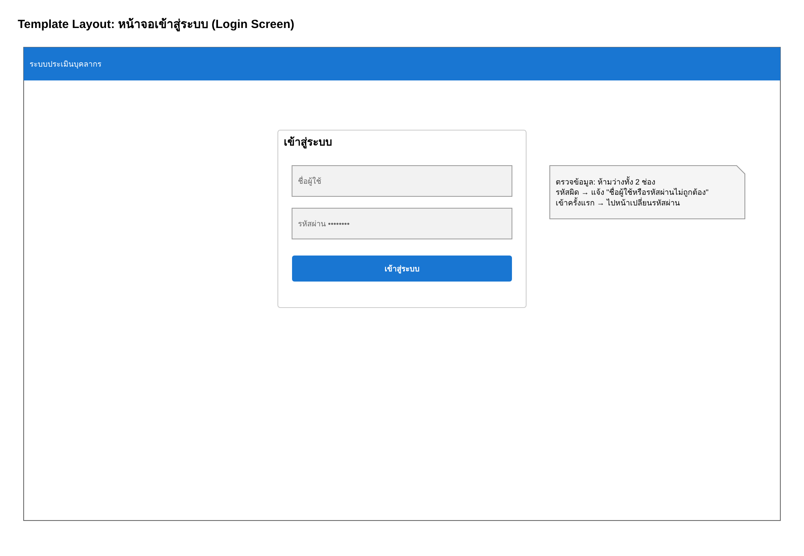
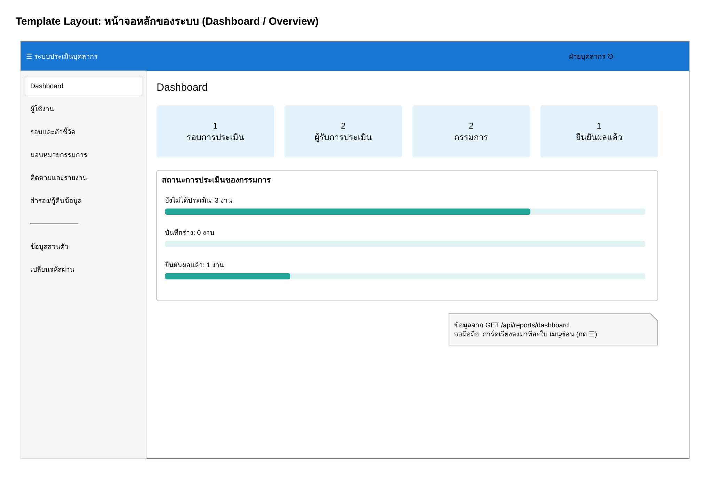
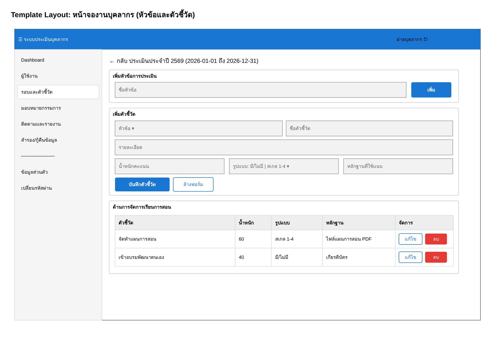
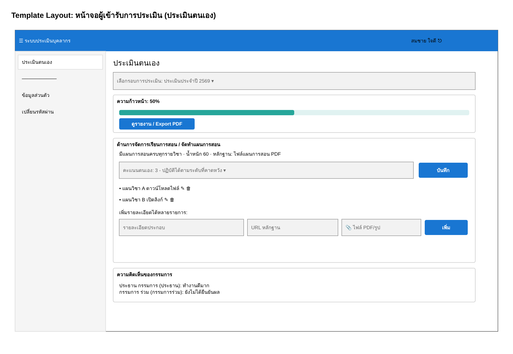
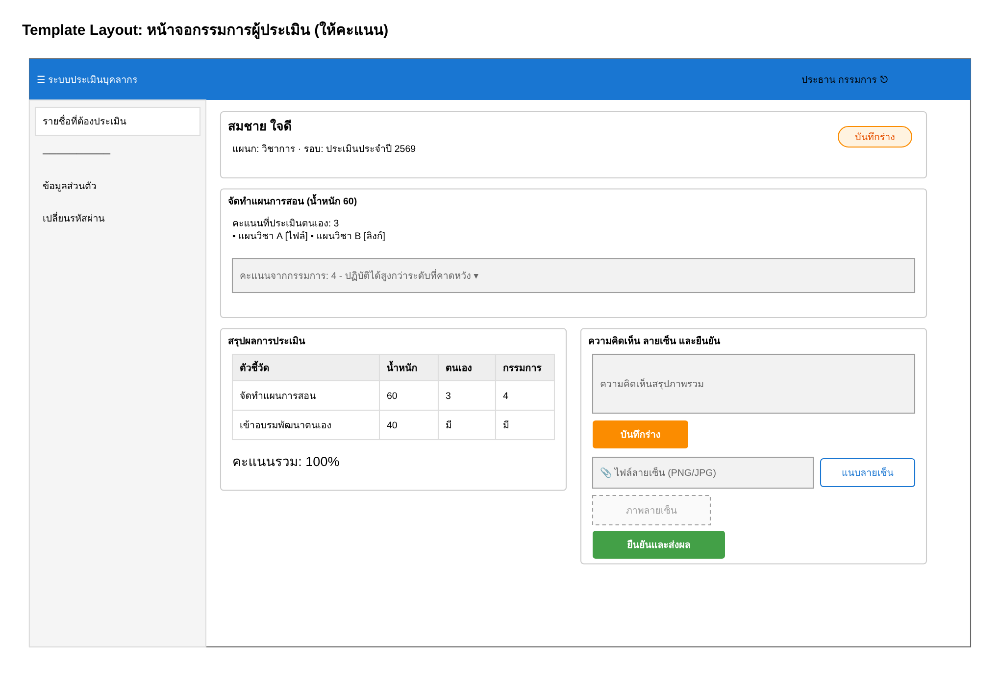
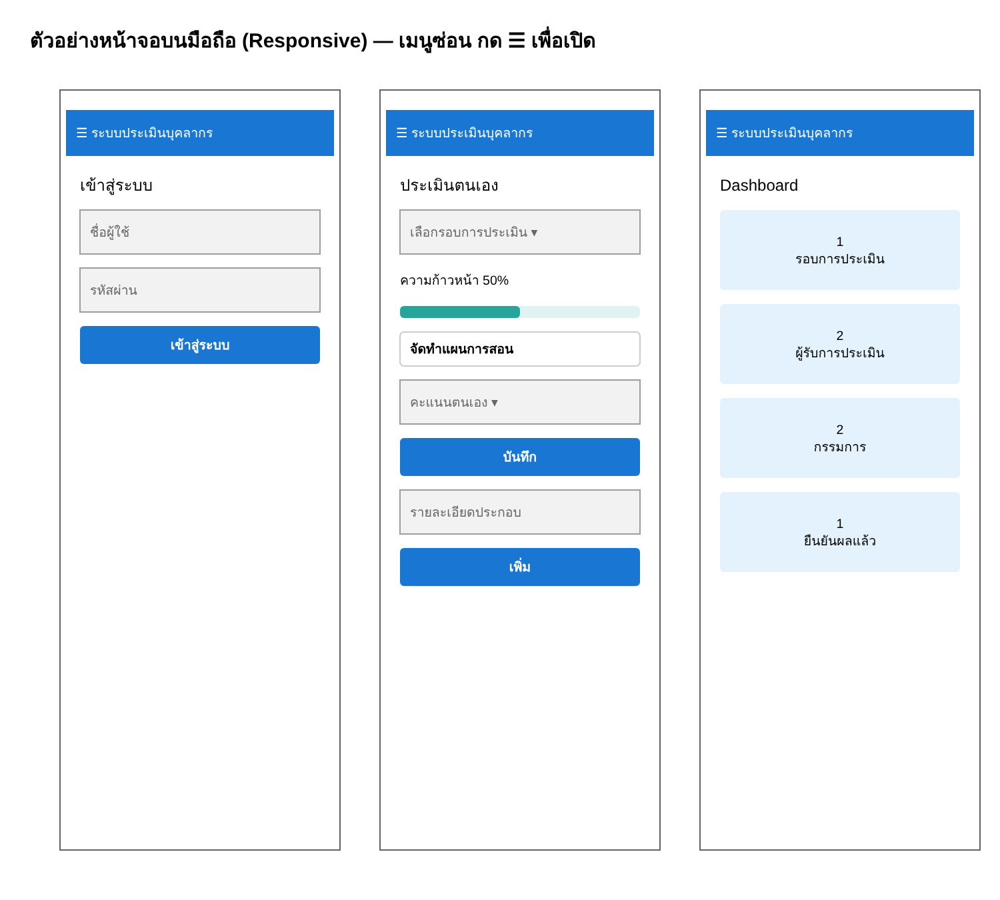

# 04 ส่วนที่ 3 การออกแบบหน้าจอด้วยโปรแกรมสำเร็จรูป — 5 คะแนน

ผู้รับผิดชอบ: **คนที่ 3** (วาดใน Draw.io) และส่งให้ **คนที่ 2** ใช้เป็นแบบเขียนหน้าเว็บ · ไฟล์ตัวอย่าง: `งานออกแบบ/3-ออกแบบหน้าจอ.drawio`

## 1. หลักการวาด Template Layout

- ทุกหน้า (ยกเว้น Login) ใช้ **โครงเดียวกัน**: แถบบนสีน้ำเงิน (ชื่อระบบ + ชื่อผู้ใช้ + ปุ่มออก) · เมนูซ้าย (ตามบทบาท) · พื้นที่เนื้อหา
- ปุ่มหลักสีน้ำเงิน · ปุ่มลบสีแดง · บันทึกร่างสีส้ม · ยืนยันสีเขียว (สีเหมือนกันทุกหน้า)
- ช่องกรอกเป็นสี่เหลี่ยมพื้นเทา มีข้อความบอกว่าให้กรอกอะไร
- ใน Draw.io ใช้แถบซ้าย **Mockups** (More Shapes → ติ๊ก Mockups) หรือใช้สี่เหลี่ยมธรรมดาก็พอ
- วาดหน้าแรกเสร็จแล้ว **Duplicate หน้า** (คลิกขวาที่แท็บหน้า → Duplicate) แล้วแก้แค่เนื้อหา ประหยัดเวลามาก

## 2. หน้าจอที่ต้องวาด

### 3.1 หน้าจอเข้าสู่ระบบ (Login Screen)

### 3.2 หน้าจอหลัก (Dashboard / Overview)

### 3.3 หน้าจองานบุคลากร

### 3.4 หน้าจอผู้เข้ารับการประเมิน

### 3.5 หน้าจอกรรมการผู้ประเมิน

### เพิ่มเติม: หน้าจอบนมือถือ (ใช้ตอบข้อ 7.10 Responsive)

## 3. แบบหน้าจอ → หน้าเว็บจริง

| แบบ | ไฟล์ Vue ที่คนที่ 2 สร้าง | Component ของ Vuetify ที่ใช้ |
|---|---|---|
| 3.1 Login | `pages/LoginPage.vue` | `v-card`, `v-text-field`, `v-btn` |
| 3.2 Dashboard | `pages/DashboardPage.vue` | `v-row`/`v-col`, `v-card`, `v-progress-linear` |
| 3.3 งานบุคลากร | `pages/CriteriaPage.vue` (+ Users, Periods, Assign, Track) | `v-form`, `v-select`, `v-table` |
| 3.4 ผู้รับการประเมิน | `pages/SelfPage.vue` | `v-select`, `v-list`, `v-file-input` |
| 3.5 กรรมการ | `pages/EvaluatePage.vue` | `v-chip`, `v-textarea`, `v-table` |
| แถบบน + เมนูซ้าย | `App.vue` | `v-app-bar`, `v-navigation-drawer` |
